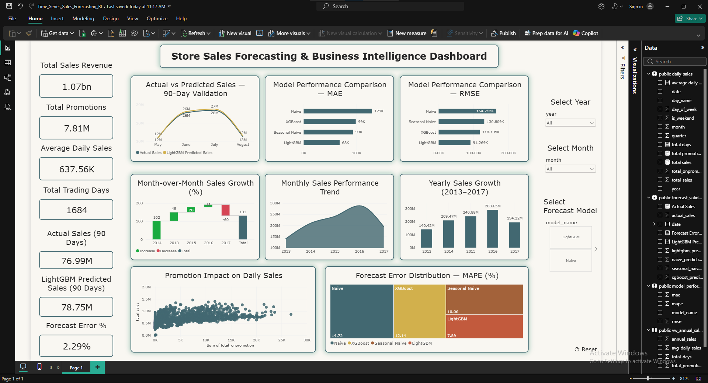
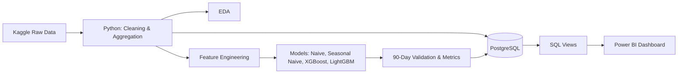

<div align="center">

# Time Series Sales Forecasting & Business Intelligence

**An end-to-end analytics solution: from raw retail data to machine learning forecasts, SQL reporting and an interactive Power BI dashboard.**


</div>



---

## Table of Contents

1. [Executive Summary](#executive-summary)
2. [Business Problem & Objectives](#business-problem--objectives)
3. [Dataset](#dataset)
4. [Solution Architecture](#solution-architecture)
5. [Methodology](#methodology)
6. [Model Performance](#model-performance)
7. [SQL Analytics Layer](#sql-analytics-layer)
8. [Power BI Dashboard](#power-bi-dashboard)
9. [Key Findings & Business Insights](#key-findings--business-insights)
10. [Limitations](#limitations)
11. [Future Improvements](#future-improvements)
12. [Repository Structure](#repository-structure)
13. [How to Reproduce](#how-to-reproduce)
14. [Author](#author)

---

## Executive Summary

This project analyzes more than **4.6 years of retail sales (3M+ records, 54 stores, 33 product families)** to understand sales performance and to forecast daily sales.

Four forecasting approaches were compared on a chronological **90-day validation window**. **LightGBM** delivered the best accuracy on every metric, with a **MAPE of 7.89%** and an MAE of 68,127, a **47% reduction in MAE** compared with the Naive baseline.

The results are delivered through a PostgreSQL reporting layer and an interactive Power BI dashboard, so both analysts and decision-makers can explore historical performance and model accuracy.

| Headline Metric | Result |
|---|---:|
| Total historical sales | **1.07 billion** |
| Best model | **LightGBM** |
| Best MAPE (90-day validation) | **7.89%** |
| Total forecast error (90-day aggregate) | **2.29%** |
| Highest full-year sales | **2016 (~288.65M)** |

---

## Business Problem & Objectives

Retail planning (inventory, staffing, promotions) depends on knowing what sales will look like in the coming weeks. This project addresses that need by:

- Analyzing historical sales trends and seasonality.
- Measuring monthly and yearly sales performance and growth.
- Exploring the relationship between promotions and sales.
- Building and comparing multiple forecasting models.
- Evaluating accuracy with MAE, RMSE and MAPE.
- Communicating results through a SQL layer and an interactive dashboard.

---

## Dataset

**Name:** Store Sales – Time Series Forecasting
**Source:** [Kaggle](https://www.kaggle.com/competitions/store-sales-time-series-forecasting)

| Attribute | Value |
|---|---|
| Records | 3,000,888 |
| Stores | 54 |
| Product families | 33 |
| Unique dates | 1,684 |
| Date range | 1 Jan 2013 – 15 Aug 2017 |

**Source files:** `train.csv`, `test.csv`, `stores.csv`, `oil.csv`, `holidays_events.csv`, `transactions.csv`, `sample_submission.csv`

---

## Solution Architecture



**Technology Stack**

| Layer | Tools |
|---|---|
| Data processing | Python, Pandas, NumPy |
| Visualization (EDA) | Matplotlib, Seaborn |
| Modeling | XGBoost, LightGBM, Scikit-learn |
| Database & reporting | PostgreSQL |
| Business intelligence | Power BI |
| Development & publishing | Jupyter Notebook, Git, GitHub |

---

## Methodology

### 1. Data Preparation
- Loaded and inspected the historical sales dataset.
- Checked missing values and duplicate records.
- Reviewed sales distribution and promotional activity.
- Aggregated store and product-family sales into **daily total sales**.

### 2. Exploratory Data Analysis
- Daily sales trends and seasonality
- Monthly and yearly performance
- Day-of-week patterns
- Product family and store-level performance
- Promotional activity vs. sales

### 3. Feature Engineering

| Category | Features |
|---|---|
| Calendar | Year, Month, Quarter, Day of Week, Day of Year, Weekend indicator |
| Lag | Sales Lag 1, 7, 28 |
| Rolling mean | 7-day and 28-day |
| Rolling volatility | 7-day and 28-day standard deviation |

> **Leakage control:** all lag and rolling features are built only from past observations, so no future information reaches the model.

### 4. Validation Design
- **Chronological split**, with the last **90 days** held out as the validation set. No random shuffling.
- Four approaches compared: Naive, Seasonal Naive, XGBoost, LightGBM.

### 5. Evaluation Metrics

| Metric | Meaning |
|---|---|
| **MAE** | Average absolute error, in sales units |
| **RMSE** | Like MAE but penalizes large errors more heavily |
| **MAPE** | Average percentage error, comparable across scales |

---

## Model Performance

**90-Day Validation Results**

| Rank | Model | MAE | RMSE | MAPE |
|:---:|---|---:|---:|---:|
| 1 | **LightGBM** | **68,126.91** | **91,268.85** | **7.89%** |
| 2 | Seasonal Naive | 93,467.95 | 130,808.95 | 10.06% |
| 3 | XGBoost | 98,647.41 | 118,135.31 | 12.14% |
| 4 | Naive | 129,317.64 | 164,712.49 | 14.72% |

**LightGBM achieved the lowest error on all three metrics.** Compared with the Naive baseline, it reduced MAE by about 47% and RMSE by about 45%.

> **Reading the dashboard KPIs:** the *Forecast Error %* KPI (2.29%) compares **total** predicted sales (78.75M) with **total** actual sales (76.99M) over the 90 days. **MAPE (7.89%)** is the average of **daily** percentage errors. They measure different things, and daily errors partly offset each other in the aggregate.

Supporting result files are stored in [`data/processed/`](Time-Series-Sales-Forecasting/data/processed/), including forecast outputs and feature importance for both models.

---

## SQL Analytics Layer

Daily sales and model evaluation results were loaded into PostgreSQL to support reporting and validation.

| Object | Type | Purpose |
|---|---|---|
| `daily_sales` | Table | Aggregated daily sales and promotion data |
| `forecast_validation` | Table | Actual vs. predicted values for the 90-day window |
| `model_performance` | Table | MAE, RMSE and MAPE per model |
| `vw_monthly_sales_performance` | View | Monthly sales and growth |
| `vw_annual_sales_performance` | View | Annual sales and growth |
| `vw_sales_business_summary` | View | Consolidated business summary |

**Techniques used:** aggregations, Common Table Expressions (CTEs), window functions, `LAG()`, `RANK()`, month-over-month growth, annual analysis and data validation checks.

<details>
<summary><b>Example: month-over-month growth (simplified)</b></summary>

```sql
WITH monthly AS (
    SELECT
        year,
        month,
        SUM(sales) AS monthly_sales
    FROM daily_sales
    GROUP BY year, month
)
SELECT
    year,
    month,
    monthly_sales,
    ROUND(
        (monthly_sales - LAG(monthly_sales) OVER (ORDER BY year, month))
        / NULLIF(LAG(monthly_sales) OVER (ORDER BY year, month), 0) * 100, 2
    ) AS mom_growth_pct
FROM monthly
ORDER BY year, month;
```

The complete script is available in [`sql/time_series_sales_forecasting_analysis.sql`](Time-Series-Sales-Forecasting/sql/time_series_sales_forecasting_analysis.sql).

</details>

---

## Power BI Dashboard

An interactive dashboard for monitoring historical sales and comparing forecasting results.

**Key Performance Indicators**

| KPI | Value |
|---|---:|
| Total Sales Revenue | 1.07bn |
| Total Promotions | 7.81M |
| Average Daily Sales | 637.56K |
| Total Trading Days | 1,684 |
| Actual Sales (90 days) | 76.99M |
| LightGBM Predicted Sales (90 days) | 78.75M |
| Forecast Error % | 2.29% |

**Visualizations**

| Area | Visual |
|---|---|
| Forecasting | Actual vs. Predicted Sales (90-Day Validation) |
| Model comparison | MAE comparison, RMSE comparison, MAPE error distribution |
| Trends | Monthly Sales Performance Trend, Yearly Sales Growth (2013–2017) |
| Growth | Month-over-Month Sales Growth (waterfall) |
| Drivers | Promotion Impact on Daily Sales (scatter) |

**Interactive filters:** Year, Month and Forecast Model.

**Files:** [`Time_Series_Sales_Forecasting_BI.pbix`](Time-Series-Sales-Forecasting/powerbi/Time_Series_Sales_Forecasting_BI.pbix) (open in Power BI Desktop)

---

## Key Findings & Business Insights

| # | Finding | Business Meaning |
|:---:|---|---|
| 1 | Total historical sales exceeded **1.07 billion**. | Large, consistent sales base suitable for forecasting. |
| 2 | **2016** was the highest full year (~288.65M). | Clear long-term growth through 2016. |
| 3 | **December 2016** was the peak month (~29.64M). | Strong year-end seasonality; plan inventory and staffing ahead. |
| 4 | **2014** grew ~49.18% over 2013. | Rapid expansion phase early in the period. |
| 5 | **March 2014** had the highest MoM growth (~69.17%). | A pronounced growth spike worth investigating further. |
| 6 | **LightGBM** outperformed all other models. | Lag and rolling features add real predictive value over naive baselines. |
| 7 | 2017 totals (~194.22M) cover only part of the year (data ends 15 Aug 2017). | 2017 should not be compared directly with full years. |

> Promotional activity and sales were explored to support business understanding. Observed relationships do **not** prove causation.

---

## Limitations

- Forecasting was done on **aggregate daily sales**, not at store–product level.
- Evaluation used **one** chronological 90-day holdout window.
- Validation performance does not guarantee equal performance on future periods.
- Oil prices, holidays, store attributes and transactions were **not** used as predictors in the final model.
- The dashboard shows **historical validation**, not a production future forecast.

## Future Improvements

- Add holidays, oil prices, store metadata and transactions as external features.
- Use walk-forward (rolling-origin) cross-validation for more robust evaluation.
- Forecast at store and product-family level.
- Tune hyperparameters and test additional models (e.g., Prophet, SARIMA).
- Generate a true future forecast and automate the data refresh pipeline.

---

## Repository Structure

```text
time-series-sales-forecasting-bi/
│
├── Time-Series-Sales-Forecasting/
│   │
│   ├── data/
│   │   └── processed/
│   │       ├── daily_sales.csv
│   │       ├── feature_importance_comparison.csv
│   │       ├── final_forecast_comparison.csv
│   │       ├── final_forecast_comparison_90day.csv
│   │       ├── lightgbm_90day_forecast_results.csv
│   │       ├── lightgbm_feature_importance_90day.csv
│   │       ├── lightgbm_forecast_results.csv
│   │       ├── model_comparison_90day.csv
│   │       ├── model_performance_comparison.csv
│   │       └── xgboost_forecast_results.csv
│   │
│   ├── notebooks/
│   │   └── sales_forecasting_analysis.ipynb
│   │
│   ├── powerbi/
│   │   ├── Time_Series_Sales_Forecasting_BI.pbix
│   │   └── time-series-sales-forecasting-dashboard.png
│   │
│   └── sql/
│       └── time_series_sales_forecasting_analysis.sql
│
└── README.md
```

---

## How to Reproduce

```bash
# 1. Clone the repository
git clone https://github.com/SABBIR-HOSSAIN-001/time-series-sales-forecasting-bi.git
cd time-series-sales-forecasting-bi

# 2. Install dependencies
pip install pandas numpy matplotlib seaborn scikit-learn xgboost lightgbm jupyter
```

1. Download the raw dataset from the [Kaggle competition page](https://www.kaggle.com/competitions/store-sales-time-series-forecasting). Raw files are not included in this repository.
2. Run `Time-Series-Sales-Forecasting/notebooks/sales_forecasting_analysis.ipynb` to regenerate the processed files.
3. Execute `sql/time_series_sales_forecasting_analysis.sql` in PostgreSQL and load the processed CSVs.
4. Open the `.pbix` file in Power BI Desktop and refresh the data source.

---

## Author

**Sabbir Hossain**
Aspiring Data Analyst | BI Engineer

[](https://github.com/SABBIR-HOSSAIN-001)
[](https://linkedin.com/in/sabbir-hossain-6a7149435/)

---

<div align="center">

*Built as an end-to-end Data Analytics, Machine Learning and Business Intelligence portfolio project.*

</div>
